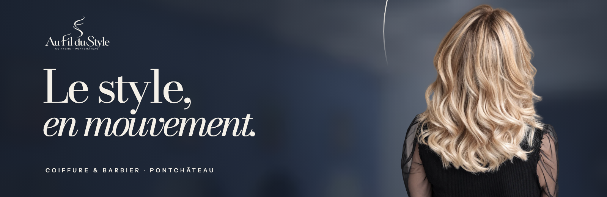
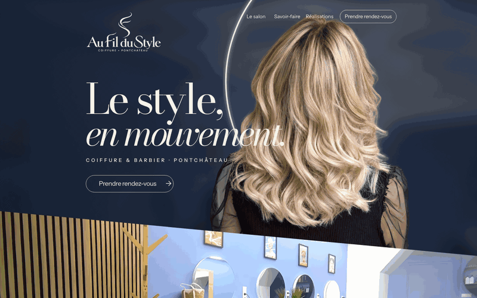
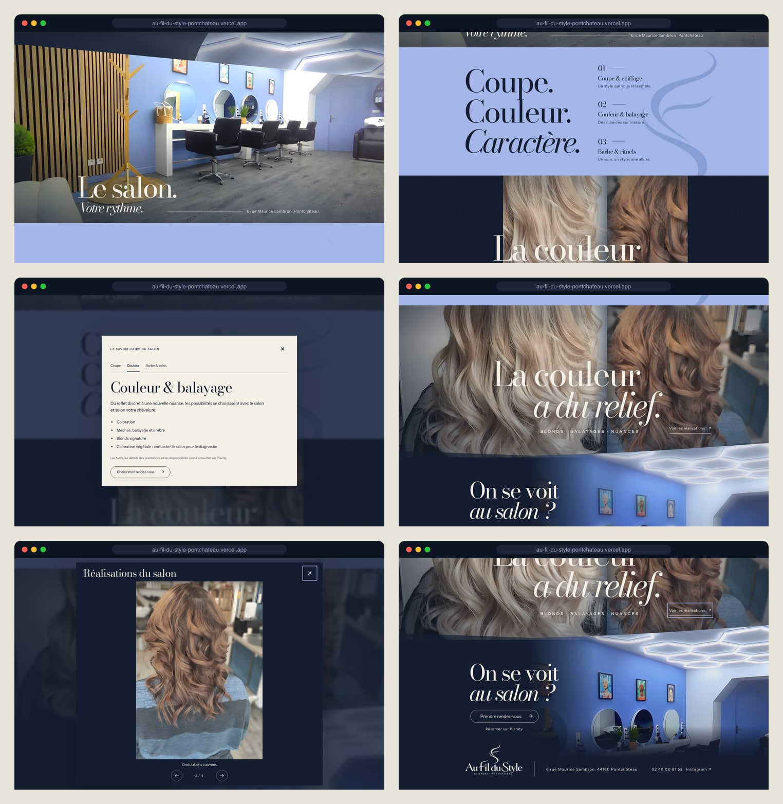
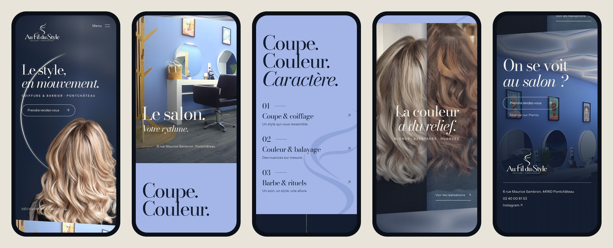
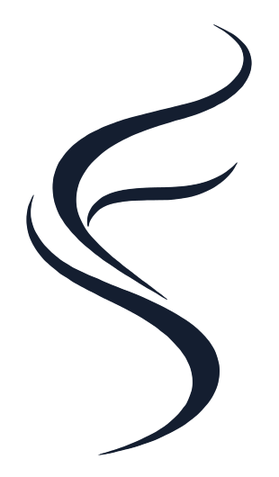

<div align="center">



<h3>A one-page website for a hair salon in Pontchâteau, built around a pinned hero where a round mirror opens onto the salon.</h3>

<p>
  <a href="https://au-fil-du-style-pontchateau.vercel.app"><strong>🌐 Live site</strong></a>
  &nbsp;·&nbsp;
  <a href="#hero-animation"><strong>🎬 How the hero works</strong></a>
  &nbsp;·&nbsp;
  <a href="#getting-started"><strong>🛠️ Run it locally</strong></a>
</p>

<p>
  <a href="https://au-fil-du-style-pontchateau.vercel.app"></a>
  
  
  
  
</p>

</div>

<br />

## 🚀 Overview

**Au Fil du Style** is a hair salon and barber at 6 rue Maurice Sambron, Pontchâteau. The site follows the client's approved design (model 1, *L’Art du Mouvement*) scene by scene: ink-blue hero with blond waves in front of a ring of light, the real salon, a single periwinkle pause for the services, blond and copper side by side, and a last look at the room before booking on Planity.

The page keeps one thread from top to bottom: **the round mirror**. Its light rim frames the hero, it opens onto the room as you scroll, and the salon's own round mirrors carry the story down to the booking scene.

- **The approved board, reproduced**: on desktop every title, link and photo sits where the approved image has it, at the density of a 1024 px board
- **The real salon**: every photo is the salon's own (blue walls, round mirrors, hexagon lights), cleaned of capture UI and upscaled, never replaced by a render
- **One path to booking**: every booking button opens the salon's Planity page, next to phone, Instagram and Maps; no fake calendar or confirmation
- **Light**: about 540 KB on first load (measured on the live site at 1440 × 900 and on a 390 px phone), fonts and images self-hosted

<br />

<a name="hero-animation"></a>

## 🎬 The hero animation

<div align="center">
  <a href="https://au-fil-du-style-pontchateau.vercel.app"></a>
  <sub>Scroll-scrubbed on the live site · captured at 1440 × 900</sub>
</div>

<br />

The hero stays pinned while the salon scene rises over it: 420 board px of scroll (590 px at 1440 × 900), after which both move on together.

| Scroll  | What happens                                                                                          |
| :------ | :---------------------------------------------------------------------------------------------------- |
| 0%      | The approved composition: logo, **Le style, en mouvement.**, **Prendre rendez-vous**, the salon's diagonal edge below |
| 10–88%  | Inside the light ring, the blurred room comes into focus: a circle opens from the mirror's centre onto the salon's hexagon lights |
| 22–65%  | Title, tagline, navigation and booking pill fade and lift 32 px; once nearly invisible they become inert |
| 34–100% | The hair drifts 20 px, grows to 1.045 and fades out as the mirror takes over                           |
| 72–100% | The light ring, which has turned 12° on the way, fades                                                 |
| 100%    | The salon reaches the top of the screen; **Le salon. Votre rythme.** rises from its mask              |

**Under the hood**

- 🧩 **Five planes, no video**: blurred room, the same room sharp behind a `clip-path` circle, an SVG light ring, the hair foreground with real alpha, and the live text.
- 📐 **Measured, not guessed.** The hair plate was placed by **SIFT registration** against the approved board (0.406 board px per plate px, 2.16°); every text line sits on the baseline measured from the board's ink (`scripts/fit-type.py`, `scripts/type-spec.py`).
- 📏 **Board units.** `u = min(width, 1600, 1.66 × height) / 1024`: the 735 px board becomes a centred frame drawn at the density of a 1024 px board, photos and colour bleed to the page edges, and short wide screens never get a zoomed page.
- 🐢 **No render loop.** One `requestAnimationFrame` per scroll, resize or pointer event. Pause, `prefers-reduced-motion` and data saver remove the pin and every hidden state; the page is then exactly the board at rest.

<br />

## 🖥️ Sections

<div align="center">
  
</div>

<br />

| #   | Section                          | Anchor          | Role                                                                                         |
| :-- | :------------------------------- | :-------------- | :------------------------------------------------------------------------------------------- |
| 01  | **Le style, en mouvement.**      | `#accueil`      | First impression, navigation and first booking link                                          |
| 02  | **Le salon. Votre rythme.**      | `#salon`        | The real interior under a diagonal edge; the address line draws in                           |
| 03  | **Coupe. Couleur. Caractère.**   | `#savoir-faire` | The only plain background: three service lines, each opens a dialog with the salon's categories |
| 04  | **La couleur a du relief.**      | `#realisations` | Blond and copper open from the seam like two doors; **Voir les réalisations** opens a four-photo gallery |
| 05  | **On se voit au salon ?**        | `#rendez-vous`  | The room comes into focus, Planity booking, then logo, address, phone and Instagram          |

Each scene moves differently: a pinned stack with the mirror portal, mask-rising lines, horizontal wipes with the brand strand drifting against the scroll, doors opening from the seam with a slow counter-zoom, and a rack focus on the booking room.

<br />

## 📱 Mobile first, motion optional

<div align="center">
  
</div>

<br />

- Phones get their own composition with the same order and identity: title above the hair, the salon rising over the hero for one screen, the booking room as a top band that melts into the footer
- Menu built on `<details>`, so it opens without JavaScript
- Every touch target is at least 44 px; no horizontal scroll at 360 px
- The pause button (bottom right) is remembered on the device; with reduced motion it is disabled and says why

<br />

## ✨ Highlights

- **🪞 Mirror portal**: the circle opens exactly inside the light ring, in px computed every frame, so it stays on the rim at any width
- **🧹 Clean real photos**: the Planity carousel buttons were removed by un-blending the translucent disc (fitted on the flat wall: observed = 0.45 × photo + 13) and inpainting only the chevron; Instagram headers are cropped; Real-ESRGAN x4 then keeps wide screens sharp
- **🔠 Type fitted to the board**: Bodoni Moda instanced at optical size 18 from the official variable font, the cut whose hairlines match the approved display type
- **💬 Accessible dialogs**: services in tabs (arrows, Home, End), gallery with arrow keys, Escape, click outside and focus returned to the opener
- **🖼️ Image pipeline**: originals kept untouched in `images/originals/`, AVIF + WebP per width generated with `npm run images`
- **✅ Checked by script**: `npm run qa` runs 62 checks (six widths, pin states, links, dialogs, no-JS, reduced motion, pause, process words, kit not served); `npm run compare` renders board | page | blend
- **🔎 Ready to share**: Open Graph image, structured data (`HairSalon`), favicon and touch icon

<br />

## 💻 Tech stack

| <br />Vite 6 | <br />JavaScript | <br />HTML5 | <br />CSS3 | <br />Python | <br />OpenCV | <br />Vercel |
| :---: | :---: | :---: | :---: | :---: | :---: | :---: |

### Why this stack?

- **Vite + plain JavaScript**: a static page with one small module (about 11 KB) and no framework runtime; a Vite plugin turns `` into `<picture>` with AVIF/WebP srcsets at build time
- **Own scroll engine**: the brief asks for no permanent render loop, so motion runs on `requestAnimationFrame` only when the page moves
- **Python for the assets, not the page**: OpenCV (registration, inpainting), Real-ESRGAN (upscaling) and fontTools (font instances) prepare files once; the site never needs them
- **Vercel**: every push to `main` deploys automatically

<br />

## 🎨 Design system

| Token          | Value                                                                                 | Use                                          |
| :------------- | :------------------------------------------------------------------------------------ | :------------------------------------------- |
| Bleu encre     |           | Hero, shades, dialogs, footer                |
| Pervenche      |           | The single plain scene (Savoir-faire), focus |
| Porcelaine     |           | Type on photos, light ring, dialogs          |
| Bois doux      |           | Occasional warm detail                       |

- **Type**: Bodoni Moda 400 roman and italic (opsz 18) for titles, Instrument Sans 400/500/600 for text, links and buttons; display sizes come from the board (hero 89.8 board px, services 84.5, colour scene 93.2)
- **Grid**: the board itself; desktop positions are board px × `u`, small text never below 11 px
- **Logo**: the approved PNG with real alpha, porcelaine on ink; the services watermark is the logo's own strand symbol
- **Motion**: reveals of 14–18 px over 0.9–1.15 s on `cubic-bezier(.2, .75, .25, 1)`; photo parallax capped at ±0.8 × 24 px (12 px on phones)

<br />

<a name="getting-started"></a>

## 🛠️ Getting started

```bash
# Clone the repository
git clone https://github.com/Jeanfr1/Au-Fil-Du-Style-website.git
cd Au-Fil-Du-Style-website

# Install dependencies (Node 20.9+)
npm install

# Start the dev server  →  http://localhost:4366
npm run dev

# Production build  →  dist/
npm run build

# Preview the production build  →  http://localhost:4367
npm run preview

# Checks against the preview (or against the live site by changing QA_BASE)
QA_BASE=http://localhost:4367/ npm run qa
QA_BASE=http://localhost:4367/ npm run compare    # qa/board-compare.png

# Rebuild the images: clean + upscale the photos (Python with OpenCV and torch), then AVIF/WebP
npm run prepare-images
npm run images
```

<br />

## 📁 Project structure

```
Au-Fil-Du-Style-website/
├── index.html                  # Five scenes: accueil → salon → savoir-faire → réalisations → rendez-vous + footer
├── src/
│   ├── main.js                 # Board geometry, hero pin + mirror, per-scene motion, reveals, dialogs, gallery
│   ├── styles/main.css         # Tokens, board layout (≥ 1024 px), phone composition, motion states
│   └── data/
│       ├── content.js          # Services and gallery copy (French)
│       ├── board-type.json     # Every text line measured on the approved board
│       └── images.json         # Plate sizes and widths (generated)
├── public/                     # Fonts (WOFF2 + OFL), img/ (AVIF/WebP), brand strand, favicon, og.jpg, robots.txt
├── scripts/
│   ├── prepare-images.py       # Carousel buttons out, Instagram headers cropped, Real-ESRGAN x4
│   ├── build-images.mjs        # AVIF + WebP per width (sharp)
│   ├── build-fonts.py          # Bodoni Moda opsz 18 + Instrument Sans → WOFF2
│   ├── register-board.py       # SIFT registration of the plates on the board
│   ├── fit-type.py · type-spec.py  # Ink boxes, sizes, tracking and baselines from the board
│   ├── qa.mjs · compare-board.mjs  # Automated checks and board comparison
│   └── readme-assets.mjs       # Banner, GIF frames and screenshots of this README
├── references/                 # Approved board (model 1) and the client's choice
├── images/                     # Original photos (byte for byte) and the hero foreground master
├── brand/ · fonts/ · roteiros/ · docs/ · motion/ · site/ · tools/   # The design kit, kept as delivered
└── LEIA-ME-KIT.md              # The kit's own README (Portuguese)
```

<br />

## 🚀 Deployment

Hosted on **Vercel** and connected to this repository: every push to `main` ships to production.

**Live site:** [au-fil-du-style-pontchateau.vercel.app](https://au-fil-du-style-pontchateau.vercel.app)

| Setting          | Value           |
| :--------------- | :-------------- |
| Framework        | Vite            |
| Build command    | `npm run build` |
| Output directory | `dist`          |

The site is served with `noindex` (meta, `X-Robots-Tag` and `robots.txt`) until the final domain is chosen. Only `dist/` is published: the kit folders return 404.

<br />

## 📌 Content checklist

Items waiting on the client. Each one is marked `TODO(aufil)` in `index.html`.

- [ ] Final domain (then set `canonical` and `og:url`, and remove `noindex`)
- [ ] Google Maps place link for the salon (the address links to a search for now)
- [ ] Mentions légales: SIRET and host, once the salon provides them
- [ ] Confirm that the Instagram and Planity photos may be used on the site

Choices made where the brief left room:

- The board's photos are generated re-renders; the site uses the salon's real photos framed to the board's composition, as the kit's implementation script asks
- Bodoni Moda at optical size 18 instead of the kit's opsz 64 instances: same family, the hairlines of the approved board
- The mirror reveals the close view of the salon (`salon-proche`), so the hero never shows the same picture as the scene rising over it
- The footer adds phone and Instagram from the kit's copy file, on the board's address line
- **Découvrir le salon** appears on phones only; the board's desktop hero has no scroll cue

<br />

## 🙏 Acknowledgments

- **Au Fil du Style** for the photos of the salon and the approved direction
- **[Bodoni Moda](https://fonts.google.com/specimen/Bodoni+Moda)** by Owen Earl (OFL) and **[Instrument Sans](https://fonts.google.com/specimen/Instrument+Sans)** by Instrument (OFL)
- **[Real-ESRGAN](https://github.com/xinntao/Real-ESRGAN)** by Xintao Wang et al. (BSD-3-Clause) and **[OpenCV](https://github.com/opencv/opencv)**
- **[Vite](https://vite.dev)** and **[Vercel](https://vercel.com)**

<br />

---

<div align="center">
  
  <p><strong>Le style, en mouvement.</strong></p>
  <p>Built with ❤️ by <a href="https://github.com/Jeanfr1">Jean</a> for Au Fil du Style</p>
  <sub>© 2026 Au Fil du Style. All rights reserved.</sub>
</div>
